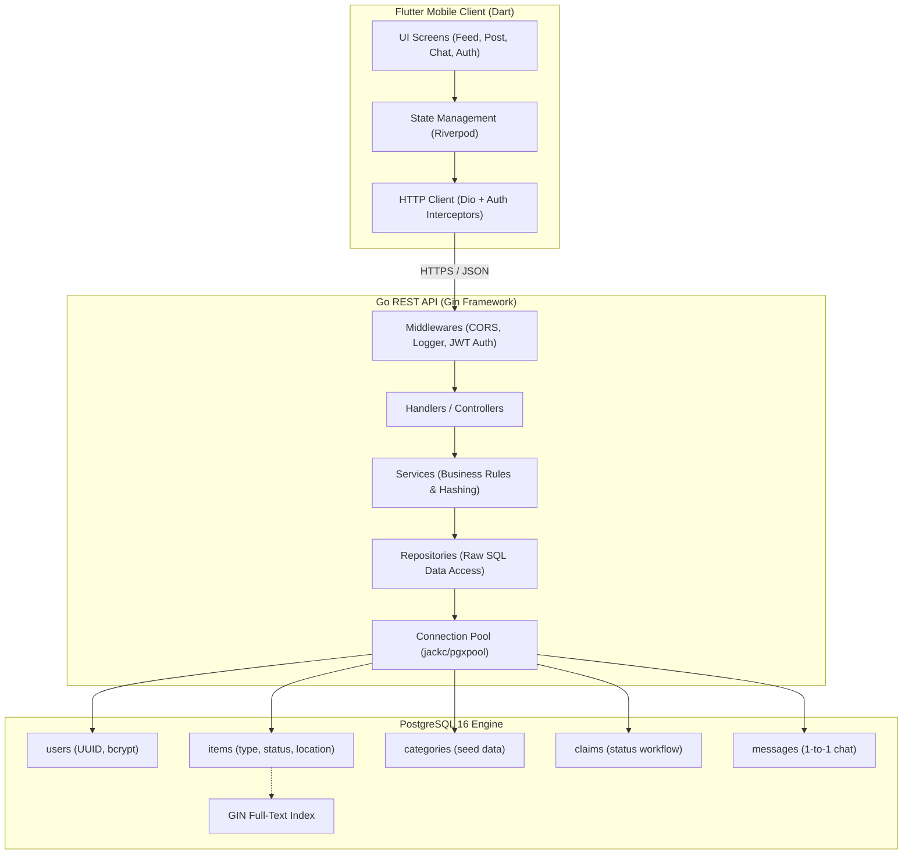

# FindIt: Project-Based Learning Guide

Welcome to the **FindIt** learning handbook! This document is our conceptual reference book. It explains the *why*, the architecture patterns, the code design, and the lessons learned throughout the development of the FindIt platform.

> [!NOTE]
> For the actionable, step-by-step implementation checklist and progress tracker, see [**`STEPS.md`**](file:///C:/Users/hp/Desktop/Findlt/STEPS.md).

---

## Table of Contents
1. [Project Overview & Philosophy](#1-project-overview--philosophy)
2. [Master Architecture Diagram](#2-master-architecture-diagram)
3. [Phase 1: Environment & Database Foundation](#3-phase-1-environment--database-foundation)
   - [Step 1: Git Repository & Dockerized PostgreSQL](#step-1-git-repository--dockerized-postgresql)
   - [Step 2: Relational Database Schema & SQL Migrations](#step-2-relational-database-schema--sql-migrations)
4. [Phase 2: Go Backend Architecture](#4-phase-2-go-backend-architecture)
   - [Clean Architecture & Layered Separation](#clean-architecture--layered-separation)
   - [The Restaurant Analogy](#the-restaurant-analogy)
   - [Step 3.1: Go Module Initialization & Core Dependencies](#step-31-go-module-initialization--core-dependencies)
   - [High-Performance Connection Pooling (`pgxpool`)](#high-performance-connection-pooling-pgxpool)
   - [Health Check Endpoints](#health-check-endpoints)

---

## 1. Project Overview & Philosophy

**FindIt** is a full-stack, mobile-first lost-and-found platform built with:
- **Frontend:** Flutter (Riverpod for state management, GoRouter for routing, Dio for API requests)
- **Backend:** Go (Gin web framework, jackc/pgx for high-performance PostgreSQL interaction)
- **Database:** PostgreSQL 16
- **Infrastructure:** Docker & Docker Compose

### Learning Approach:
- **Concept First:** Learn *why* a technology or pattern is chosen before writing code.
- **Hands-On & Modular:** Build one layer at a time.
- **Immediate Verification:** Test every step using CLI commands, SQL queries, or API calls.
- **Continuous Version Control:** Commit and push each milestone cleanly to GitHub.

---

## 2. Master Architecture Diagram



---

## 3. Phase 1: Environment & Database Foundation

### Step 1: Git Repository & Dockerized PostgreSQL

#### Why Docker for PostgreSQL?
Instead of installing PostgreSQL directly on the host operating system (which pollutes background services and differs between machines), we use Docker:
- **Portability:** Anyone cloning this repository can run `docker compose up -d` and have an identical PostgreSQL 16 instance.
- **Data Persistence:** Defined via a named volume (`pgdata:/var/lib/postgresql/data`), preserving database records even if containers are stopped or rebuilt.
- **Health Checks:** A container health check (`pg_isready`) signals when the database engine is actually ready to receive queries, preventing backend connection race conditions.

#### Key Files Created:
- `.gitignore`: Prevents secrets (`.env`), build binaries (`backend/bin/`), and mobile artifacts from ever entering git history.
- `.env.example` & `.env`: Follows the **Twelve-Factor App** configuration methodology. Configuration is decoupled from source code.
- `docker-compose.yml`: Defines the `postgres:16-alpine` service, environment variables, mapped port (`5432:5432`), and healthcheck.

#### Verification Commands:
```bash
docker compose up -d
docker compose ps
docker compose exec postgres pg_isready -U findit_user -d findit_db
```

---

### Step 2: Relational Database Schema & SQL Migrations

#### Why SQL Migrations over Manual DB Tooling?
In production systems, you cannot open a GUI tool and manually click to create tables. Changes must be version-controlled, reproducible, and reversible:
- **`*.up.sql`**: Applies changes to create or alter schema.
- **`*.down.sql`**: Safely reverts the changes if a rollback is needed.

#### Key Architectural Decisions in the Schema:
1. **UUID Primary Keys (`gen_random_uuid()`):**
   - Auto-incrementing IDs (`1, 2, 3`) allow ID enumeration attacks (guessing other users' or items' URLs).
   - UUIDv4 prevents predictability and allows IDs to be generated safely across distributed nodes.
2. **Referential Integrity & Cascading:**
   - Deleting an `item` automatically deletes its associated `claims` and `messages` (`ON DELETE CASCADE`).
   - Deleting a `category` that has active items attached is blocked (`ON DELETE RESTRICT`) to protect historical records.
3. **Strict Constraints:**
   - `CHECK (type IN ('LOST', 'FOUND'))`: Ensures items can only belong to these two core types.
   - `CHECK (status IN ('ACTIVE', 'CLAIMED', 'RESOLVED'))`: Enforces a finite state machine for item lifecycles.
   - `CONSTRAINT unique_item_claimant UNIQUE (item_id, claimant_id)`: Prevents duplicate active claims by the same user.
4. **PostgreSQL GIN Full-Text Search Index:**
   - `CREATE INDEX idx_items_search ON items USING gin (to_tsvector('english', title || ' ' || description));`
   - Enables lightning-fast, linguistic keyword search across item titles and descriptions without needing a third-party search engine.

#### Database Tables Created:
| Table | Description |
|---|---|
| `users` | User credentials, contact info, profile data |
| `categories` | Predefined item categories (Electronics, Wallets, Keys, etc.) |
| `items` | Lost or found reports with location, dates, and image URLs |
| `claims` | Formal ownership claims submitted by users |
| `messages` | Chat messages exchanged between item finders and claimants |
| `notifications` | System alerts for claims, matches, and messages |

---

## 4. Phase 2: Go Backend Architecture

### Clean Architecture & Layered Separation

The Flutter mobile application **never** talks directly to PostgreSQL for security reasons. The Go backend acts as the gatekeeper:
- Validates all input data.
- Enforces business logic (e.g., verifying ownership claims).
- Hashes and compares passwords.
- Returns clean, standardized JSON to the mobile app.

#### Project Directory Structure:
```
backend/
├── cmd/
│   └── api/
│       └── main.go         # Entrypoint (initializes components & starts HTTP server)
└── internal/
    ├── config/             # Loads and validates environment variables (.env)
    ├── database/           # Manages the pgxpool connection pool to PostgreSQL
    ├── models/             # Go structs representing database entities
    ├── repository/         # Data Access: Executes raw SQL queries
    ├── service/            # Business Logic: Validations, hashing, workflow rules
    ├── handler/            # Controllers: Receives HTTP requests, returns JSON
    └── middleware/         # Interceptors: Auth verification, CORS, Logger
```

### The Restaurant Analogy
- **Handler (The Waiter):** Takes the order (HTTP request) from the customer (Flutter), asks the kitchen, and delivers the food back (JSON response).
- **Service (The Chef):** Knows the business recipes (hashes passwords, verifies claim permissions).
- **Repository (The Pantry Worker):** The only one allowed into the storage room (PostgreSQL) to store or retrieve data.
- **Models (The Menu):** Defines the shape and structure of data.

---

### Step 3.1: Go Module & Core Dependencies

#### 1. What are `go.mod` and `go.sum`?
- **`go.mod` (Project Manifest):** Like `pubspec.yaml` in Flutter or `package.json` in Node.js. It names our backend module and lists external libraries we use.
- **`go.sum` (Security Lockfile):** Like `package-lock.json`. It saves exact cryptographic fingerprints (hashes) for each library so no one can secretly tamper with the code we download.

#### 2. The 3 Libraries We Installed & Why:
| Library | What it is | Why we use it |
|---|---|---|
| **`gin`** | Web Framework | Listens for HTTP requests from Flutter, routes them to handlers, and sends JSON back. |
| **`pgx/v5`** | PostgreSQL Driver | The fastest Go database driver. Lets Go run SQL queries and manages the connection pool. |
| **`godotenv`** | Settings Loader | Reads secrets (DB passwords, ports) from `.env` into Go so sensitive data is never hardcoded. |

#### 3. Commands Used:
```bash
cd backend
go mod init github.com/MohammedaminSa/FindIt/backend
go get github.com/gin-gonic/gin github.com/jackc/pgx/v5 github.com/joho/godotenv
```

---

### High-Performance Connection Pooling (`pgxpool`)
Opening a fresh TCP connection for every incoming HTTP request is slow and expensive.
A **Connection Pool** maintains a pool of pre-established, healthy database connections:
- A handler borrows an idle connection from the pool.
- Executes the query in a few milliseconds.
- Returns the connection to the pool for the next request.
We use `jackc/pgx/v5/pgxpool`, which is the fastest and most capable PostgreSQL driver for Go.

### Health Check Endpoints (`GET /api/v1/health`)
The first endpoint implemented in production services:
- Verifies the Gin HTTP server is alive and accepting traffic.
- Performs a live ping to PostgreSQL (`pool.Ping(ctx)`) to ensure database connectivity is intact.
