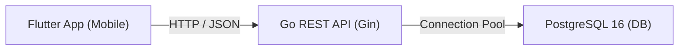

# FindIt: Project-Based Learning Guide

Welcome to the **FindIt** learning handbook! This document explains the core concepts, architectural decisions, and lessons learned in a short, clear, and beginner-friendly way.

> [!NOTE]
> For the interactive task checklist and roadmap of all 15 milestones, see [**`STEPS.md`**](file:///C:/Users/hp/Desktop/Findlt/STEPS.md).

---

## Table of Contents
1. [Architecture Overview & The Restaurant Analogy](#1-architecture-overview)
2. [Phase 1: Environment & Database](#2-phase-1-environment--database)
   - [Step 1: Git & Dockerized PostgreSQL](#step-1-git--dockerized-postgresql)
   - [Step 2: Relational Database Schema & Migrations](#step-2-relational-database-schema--migrations)
3. [Phase 2: Go Backend Architecture](#3-phase-2-go-backend-architecture)
   - [Step 3.1: Go Module & Core Dependencies](#step-31-go-module--core-dependencies)
   - [Step 3.2: Configuration Management](#step-32-configuration-management)
   - [Step 3.3: PostgreSQL Connection Pooling (`pgxpool`)](#step-33-postgresql-connection-pooling-pgxpool)
   - [Step 3.4: Health Handler & CORS Middleware](#step-34-health-handler--cors-middleware)
   - [Step 3.5 Concept: Server Entrypoint & Graceful Shutdown](#step-35-concept-server-entrypoint--graceful-shutdown)

---

## 1. Architecture Overview



### The Restaurant Analogy:
| Layer | Restaurant Role | Responsibilities |
|---|---|---|
| **Handler** | The Waiter | Takes HTTP request from Flutter, asks the service, returns JSON. |
| **Service** | The Chef | Business rules: hashes passwords, verifies claim permissions. |
| **Repository** | Pantry Worker | The only layer allowed to talk to PostgreSQL and run SQL queries. |
| **Models** | The Menu | Go structs defining data shapes (User, Item, Claim). |

---

## 2. Phase 1: Environment & Database

### Step 1: Git & Dockerized PostgreSQL

* **What is it?** Runs PostgreSQL 16 inside an isolated Docker container instead of installing it directly on the host computer.
* **Why do we use it?**
  1. **Portability:** Anyone cloning this repo runs `docker compose up -d` and gets an identical database.
  2. **Persistence:** Named volume (`pgdata`) keeps all database data safe even if containers are stopped or rebuilt.
  3. **Zero Host Clutter:** Keeps Windows clean without background services running when not needed.
* **Key Files:** `docker-compose.yml`, `.env`, `.gitignore`.
* **Verification:**
  ```bash
  docker compose exec postgres pg_isready -U findit_user -d findit_db
  ```

---

### Step 2: Relational Database Schema & Migrations

* **What is it?** 6 relational tables (`users`, `categories`, `items`, `claims`, `messages`, `notifications`) managed with version-controlled `.sql` migration files.
* **Why do we use it?**
  1. **UUIDv4 (`gen_random_uuid()`):** Prevents ID enumeration attacks (attackers cannot guess `/items/1`, `/items/2`).
  2. **Cascading Rules:** Deleting an item automatically cleans up its claims and messages (`ON DELETE CASCADE`).
  3. **GIN Full-Text Search:** High-speed keyword search on item title and description without external search engines.
  4. **Strict Constraints:** Enforces finite statuses (`ACTIVE`, `CLAIMED`, `RESOLVED`) and types (`LOST`, `FOUND`).
* **Key Files:** `backend/migrations/000001_init_schema.up.sql`, `down.sql`.
* **Verification:**
  ```bash
  psql -U findit_user -d findit_db -c "\dt"
  ```

---

## 3. Phase 2: Go Backend Architecture

### Step 3.1: Go Module & Core Dependencies

* **What is it?** Initializes Go's package manager (`go.mod`, `go.sum`) and installs our 3 core libraries.
* **Why do we use it?**
  * **`go.mod` (Project Manifest):** Like `pubspec.yaml` in Flutter or `package.json` in Node.js. Names the module and tracks packages.
  * **`go.sum` (Security Lockfile):** Stores cryptographic fingerprints (SHA-256) ensuring no downloaded code has been tampered with.
* **The 3 Libraries Installed:**
  | Library | Role | Why We Chose It |
  |---|---|---|
  | **`gin`** | Web Framework | Radix-tree router, sub-millisecond JSON API responses. |
  | **`pgx/v5`** | PostgreSQL Driver | Native binary protocol (2-3x faster than legacy `lib/pq`), built-in connection pool. |
  | **`godotenv`** | Settings Loader | Reads secrets from `.env` so passwords are never hardcoded in Go code. |
* **Key Files:** `backend/go.mod`, `backend/go.sum`.
* **Verification:**
  ```bash
  cd backend
  go mod verify
  ```

---

### Step 3.2: Configuration Management

* **What is it?** Loads all `.env` settings into a single strongly-typed Go struct (`Config`) at application startup.
* **Why do we use it?**
  1. **No Hardcoded Values:** Keeps database passwords, ports, and secret keys out of git.
  2. **Safe Defaults:** If a variable is missing, fallback defaults (e.g. `localhost`, `5432`, `8080`) prevent runtime crashes.
  3. **Centralized DSN:** `DatabaseURL()` method builds the exact connection string needed by PostgreSQL.
* **Key Files:** `backend/internal/config/config.go`, `config_test.go`.
* **Verification:**
  ```bash
  cd backend
  go test ./internal/config/... -v
  # Output: PASS: TestConfigLoadDefaults (0.00s)
  ```

---

### Step 3.3: PostgreSQL Connection Pooling (`pgxpool`)

* **What is it?** A high-performance, reusable pool of pre-opened database connections managed by `jackc/pgx/v5/pgxpool`.
* **Why do we use it?**
  1. **Zero Latency Penalty:** Opening a fresh TCP and SSL handshake for every HTTP request is slow (~50-100ms) and exhausts database memory.
  2. **Connection Reuse:** With `pgxpool`, incoming API requests borrow an already-open connection, execute SQL queries in milliseconds, and immediately return it to the pool.
  3. **Tuned Lifecycle:**
     * `MaxConns`: Caps maximum concurrent connections to prevent database overload under traffic spikes.
     * `MinConns`: Keeps pre-warmed idle connections ready for instant queries.
     * `MaxConnLifetime` & `MaxConnIdleTime`: Automatically purges and refreshes stale connections.
  4. **Startup Validation:** Verifies database reachability via `pool.Ping()` with a strict 5-second timeout, failing fast if the database is offline.
* **Key Files:** `backend/internal/database/db.go`, `db_test.go`.
* **Verification:**
  ```bash
  cd backend
  go test ./internal/database/... -v
  # Output:
  # === RUN   TestNewPoolConfig
  # --- PASS: TestNewPoolConfig (0.00s)
  # === RUN   TestNewPoolConfigInvalidDSN
  # --- PASS: TestNewPoolConfigInvalidDSN (0.00s)
  # === RUN   TestNewPoolUnreachableHost
  # --- PASS: TestNewPoolUnreachableHost (0.01s)
  # PASS
  ```

---

### Step 3.4: Health Handler & CORS Middleware

* **What is it?** A monitoring probe (`GET /api/v1/health`) and cross-origin security middleware (`CORS`) built with Gin.
* **Why do we use it?**
  1. **Uptime & Dependency Monitoring:** Cloud container platforms (Docker, Kubernetes) periodically query `/api/v1/health`. If PostgreSQL goes down, the endpoint immediately signals `503 Service Unavailable` with `status: "DEGRADED"` before end users experience runtime failures.
  2. **Testable Abstraction (`Pinger` Interface):** Uses Go interfaces so health checks can be thoroughly tested with mocks without requiring a live database container.
  3. **CORS for Flutter & Web:** Browsers and mobile emulators enforce Cross-Origin Resource Sharing. Our CORS middleware handles HTTP `OPTIONS` preflight requests, sets allowed headers, and enables smooth client-server communication.
* **Key Files:**
  * `backend/internal/handler/health.go`, `health_test.go`
  * `backend/internal/middleware/cors.go`, `cors_test.go`
* **Verification:**
  ```bash
  cd backend
  go test ./internal/handler/... ./internal/middleware/... -v
  # Output:
  # === RUN   TestHealthCheck_Healthy
  # --- PASS: TestHealthCheck_Healthy (0.00s)
  # === RUN   TestHealthCheck_Degraded
  # --- PASS: TestHealthCheck_Degraded (0.00s)
  # === RUN   TestHealthCheck_NoDB
  # --- PASS: TestHealthCheck_NoDB (0.00s)
  # === RUN   TestCORS_PreflightOptions
  # --- PASS: TestCORS_PreflightOptions (0.00s)
  # === RUN   TestCORS_RegularRequest
  # --- PASS: TestCORS_RegularRequest (0.00s)
  # PASS
  ```

---

### Step 3.5 Concept: Server Entrypoint & Graceful Shutdown

* **What is it?** The main application executable (`cmd/api/main.go`) wiring configuration, connection pool, Gin router, and OS signal listener.
* **Why do we use it?**
  * When stopping or deploying a server, `SIGINT` or `SIGTERM` signals give running HTTP requests a grace period (e.g., 5 seconds) to finish instead of abruptly severing user requests.
