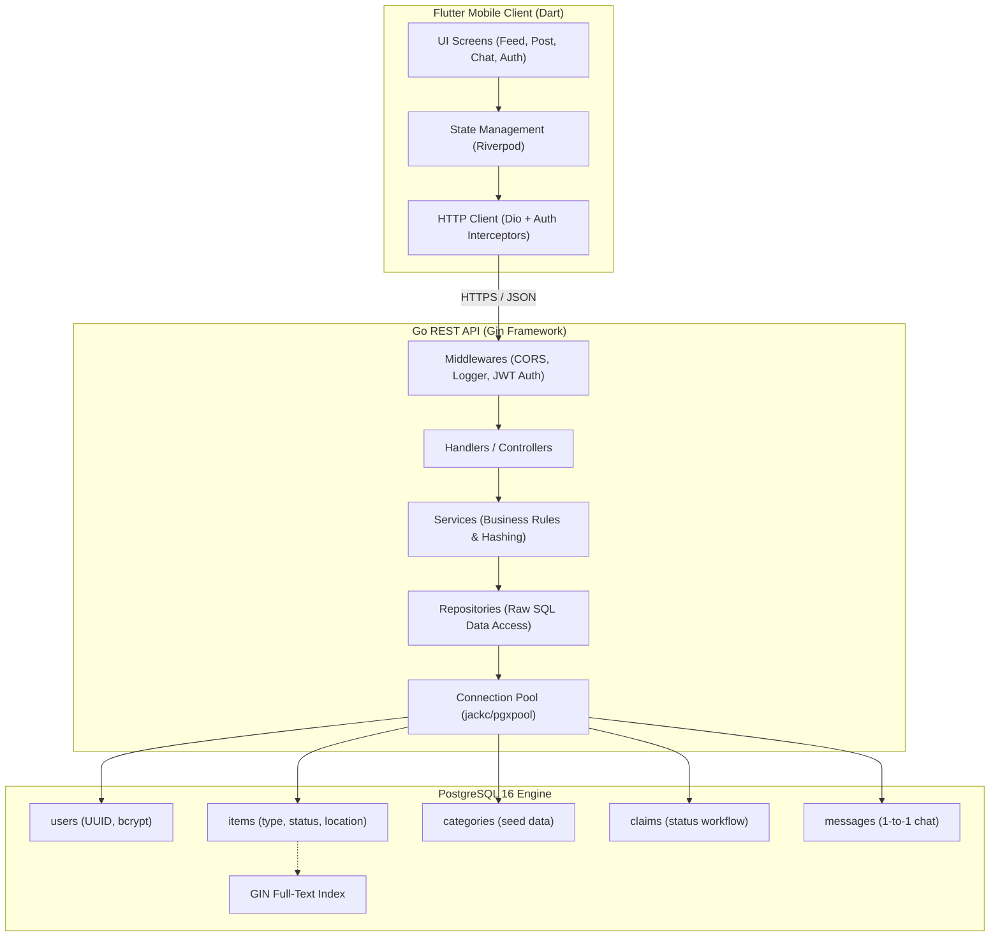

# FindIt: Project-Based Learning Guide & Master Blueprint

Welcome to the **FindIt** learning handbook! This document serves as the complete, single-source-of-truth master curriculum for the entire project. It documents every architectural decision, technology choice, step-by-step milestone, code explanation, and verification command from day one to production.

---

## Master Table of Contents

1. [Project Overview & Philosophy](#1-project-overview--philosophy)
2. [Master Architecture Diagram](#2-master-architecture-diagram)
3. [Master Progress Tracker](#3-master-progress-tracker)
4. [Phase 1: Environment & Database Foundation](#4-phase-1-environment--database-foundation)
   - [Step 1: Git Repository & Dockerized PostgreSQL](#step-1-git-repository--dockerized-postgresql)
   - [Step 2: Relational Database Schema & SQL Migrations](#step-2-relational-database-schema--sql-migrations)
5. [Phase 2: Go Backend Architecture & Security](#5-phase-2-go-backend-architecture--security)
   - [Step 3: Clean Architecture, Connection Pooling & Gin Engine](#step-3-clean-architecture-connection-pooling--gin-engine)
     - [Step 3.1: Go Module & Dependencies](#step-31-go-module--dependencies)
     - [Step 3.2: Configuration Management](#step-32-configuration-management)
     - [Step 3.3: PostgreSQL Connection Pooling](#step-33-postgresql-connection-pooling)
     - [Step 3.4: Health Check Controller & CORS Middleware](#step-34-health-check-controller--cors-middleware)
     - [Step 3.5: HTTP Server Entrypoint & Graceful Shutdown](#step-35-http-server-entrypoint--graceful-shutdown)
     - [Step 3.6: Step 3 Verification & Testing](#step-36-step-3-verification--testing)
   - [Step 4: User Authentication & Security Layer](#step-4-user-authentication--security-layer)
     - [Step 4.1: User Models & Request/Response DTOs](#step-41-user-models--requestresponse-dtos)
     - [Step 4.2: Password Hashing with Bcrypt](#step-42-password-hashing-with-bcrypt)
     - [Step 4.3: JWT Token Generation & Validation](#step-43-jwt-token-generation--validation)
     - [Step 4.4: User Data Access Repository](#step-44-user-data-access-repository)
     - [Step 4.5: Authentication Business Logic Service](#step-45-authentication-business-logic-service)
     - [Step 4.6: Auth HTTP Handlers & Routes](#step-46-auth-http-handlers--routes)
     - [Step 4.7: Protected Route Middleware](#step-47-protected-route-middleware)
     - [Step 4.8: Step 4 Verification & Testing](#step-48-step-4-verification--testing)
6. [Phase 3: Core Domain Services (Lost & Found Features)](#6-phase-3-core-domain-services-lost--found-features)
   - [Step 5: Category & Item Reporting APIs](#step-5-category--item-reporting-apis)
   - [Step 6: High-Performance Search & Filtering Engine](#step-6-high-performance-search--filtering-engine)
   - [Step 7: Ownership Claims Lifecycle & Verification Workflow](#step-7-ownership-claims-lifecycle--verification-workflow)
   - [Step 8: In-App Messaging & Notifications](#step-8-in-app-messaging--notifications)
7. [Phase 4: Flutter Mobile Application](#7-phase-4-flutter-mobile-application)
   - [Step 9: Mobile Scaffolding & State Architecture](#step-9-mobile-scaffolding--state-architecture)
   - [Step 10: Authentication UI & Auth State Flow](#step-10-authentication-ui--auth-state-flow)
   - [Step 11: Lost & Found Discovery Feed & Search UI](#step-11-lost--found-discovery-feed--search-ui)
   - [Step 12: Item Reporting Flow (Post Lost/Found)](#step-12-item-reporting-flow-post-lostfound)
   - [Step 13: Claim Submission & Claim Review Dashboard](#step-13-claim-submission--claim-review-dashboard)
   - [Step 14: Messaging & Chat Screen](#step-14-messaging--chat-screen)
8. [Phase 5: Production Deployment & DevOps](#8-phase-5-production-deployment--devops)
   - [Step 15: Production Containerization & Cloud Deployment](#step-15-production-containerization--cloud-deployment)

---

## 1. Project Overview & Philosophy

**FindIt** is a full-stack, mobile-first lost-and-found community platform designed to connect people who have lost items with those who have found them.

### Tech Stack
- **Frontend:** Flutter (Riverpod state management, GoRouter, Dio HTTP client)
- **Backend:** Go 1.26 (Gin Web Framework, jackc/pgx/v5 connection pool, JWT, Bcrypt)
- **Database:** PostgreSQL 16 (UUIDv4 keys, GIN full-text search, relational integrity constraints)
- **Infrastructure:** Docker & Docker Compose

### Project-Based Learning Principles
1. **Concept First:** Understand *why* a pattern or tool is selected before writing code.
2. **One Bite at a Time:** Never build multiple layers at once. Focus on one atomic sub-step.
3. **Immediate Verification:** Every step is run and validated (via terminal, curl, or SQL) before moving forward.
4. **Living Documentation:** This file is updated as we advance through each milestone.
5. **Clean Version Control:** Every milestone is cleanly committed and pushed to GitHub.

---

## 2. Master Architecture Diagram



---

## 3. Master Progress Tracker

| Milestone | Description | Status |
|---|---|---|
| **Step 1** | Git Repository, `.gitignore`, `.env`, Dockerized PostgreSQL 16 | ✅ **Completed** |
| **Step 2** | Relational Database Schema, SQL Migrations & Category Seeding | ✅ **Completed** |
| **Step 3** | Go Backend Architecture, Connection Pooling (`pgxpool`) & Gin Server | ⏳ **Next (Step-by-Step)** |
| **Step 4** | User Authentication (Bcrypt, JWT, Middleware & Protected Routes) | ⏸️ Pending |
| **Step 5** | Category & Item Reporting APIs (Image handling & location mapping) | ⏸️ Pending |
| **Step 6** | Search & Filtering Engine (PostgreSQL Full-Text Search with GIN index) | ⏸️ Pending |
| **Step 7** | Ownership Claims Workflow (Proof submission, approve/reject lifecycle) | ⏸️ Pending |
| **Step 8** | In-App Messaging & Notifications (1-to-1 finder-claimant chat) | ⏸️ Pending |
| **Step 9** | Flutter Scaffolding, State Management (Riverpod) & Router | ⏸️ Pending |
| **Step 10** | Mobile Auth Screens (Login, Register, Secure Token Storage) | ⏸️ Pending |
| **Step 11** | Mobile Discovery Feed & Real-time Search UI | ⏸️ Pending |
| **Step 12** | Mobile Item Reporting Form (Camera & Location integration) | ⏸️ Pending |
| **Step 13** | Mobile Ownership Claim & Finder Review Screens | ⏸️ Pending |
| **Step 14** | Mobile Chat Interface & Notification System | ⏸️ Pending |
| **Step 15** | Multi-Stage Production Docker Build & Deployment | ⏸️ Pending |

---

## 4. Phase 1: Environment & Database Foundation

### Step 1: Git Repository & Dockerized PostgreSQL

#### Why Docker for PostgreSQL?
Instead of installing PostgreSQL directly on the host OS (polluting background services and creating cross-platform differences):
- **Portability:** Anyone cloning this repository runs `docker compose up -d` and gets an identical PostgreSQL 16 environment.
- **Data Persistence:** Defined via a named volume (`pgdata:/var/lib/postgresql/data`), keeping data intact across container restarts.
- **Health Checks:** A container health check (`pg_isready`) signals when the engine is truly ready to receive traffic.

#### Key Files:
- `.gitignore`: Prevents secrets (`.env`), build binaries (`backend/bin/`), and mobile artifacts from entering git.
- `.env.example` & `.env`: Follows the **Twelve-Factor App** configuration methodology.
- `docker-compose.yml`: Defines the `postgres:16-alpine` service, environment variables, port `5432:5432`, and healthcheck.

#### Verification Commands:
```bash
docker compose up -d
docker compose ps
docker compose exec postgres pg_isready -U findit_user -d findit_db
```

---

### Step 2: Relational Database Schema & SQL Migrations

#### Why SQL Migrations over Manual DB Tooling?
In production systems, schema modifications must be version-controlled, reproducible, and reversible:
- **`*.up.sql`**: Applies changes to create or alter schema.
- **`*.down.sql`**: Safely reverts the changes if a rollback is needed.

#### Key Schema Decisions:
1. **UUID Primary Keys (`gen_random_uuid()`):** Prevents ID enumeration attacks (guessing `/items/1`, `/items/2`).
2. **Referential Integrity & Cascading:**
   - Deleting an `item` cascades to delete its claims and messages (`ON DELETE CASCADE`).
   - Deleting a `category` with active items is blocked (`ON DELETE RESTRICT`) to protect history.
3. **Strict Constraints:**
   - `CHECK (type IN ('LOST', 'FOUND'))`: Guarantees valid post types.
   - `CHECK (status IN ('ACTIVE', 'CLAIMED', 'RESOLVED'))`: Enforces a finite state machine.
   - `CONSTRAINT unique_item_claimant UNIQUE (item_id, claimant_id)`: Prevents duplicate active claims.
4. **PostgreSQL GIN Full-Text Search Index:**
   - `CREATE INDEX idx_items_search ON items USING gin (to_tsvector('english', title || ' ' || description));`
   - Enables fast linguistic search without requiring external search clusters like Elasticsearch.

#### Database Tables:
| Table | Description |
|---|---|
| `users` | User credentials, contact info, profile data |
| `categories` | Predefined item categories (Electronics, Wallets, Keys, etc.) |
| `items` | Lost or found reports with location, dates, and image URLs |
| `claims` | Formal ownership claims submitted by users |
| `messages` | Chat messages exchanged between item finders and claimants |
| `notifications` | System alerts for claims, matches, and messages |

---

## 5. Phase 2: Go Backend Architecture & Security

### Step 3: Clean Architecture, Connection Pooling & Gin Engine

#### Layered Separation of Concerns:
```
backend/
├── cmd/
│   └── api/
│       └── main.go         # Entrypoint (wires config, pool, handlers, starts HTTP server)
└── internal/
    ├── config/             # Loads and validates environment variables (.env)
    ├── database/           # Manages the pgxpool connection pool to PostgreSQL
    ├── models/             # Go structs representing database entities
    ├── repository/         # Data Access Layer: Executes raw SQL queries
    ├── service/            # Business Logic Layer: Validations, hashing, workflow rules
    ├── handler/            # Presentation Layer: Receives HTTP requests, returns JSON
    └── middleware/         # HTTP Interceptors: Auth verification, CORS, Logging
```

#### Detailed Sub-Steps for Step 3:

##### Step 3.1: Go Module & Dependencies
- **Concept:** Go modules (`go.mod`, `go.sum`) provide reproducible dependency management without global `$GOPATH` pollution.
- **Packages Used:**
  - `github.com/gin-gonic/gin`: High-performance HTTP framework.
  - `github.com/jackc/pgx/v5`: Pure Go driver and connection pool for PostgreSQL.
  - `github.com/joho/godotenv`: Twelve-Factor environment variable loader.
- **Action:** Initialize `backend/go.mod` and add dependencies.

##### Step 3.2: Configuration Management (`internal/config/config.go`)
- **Concept:** Centralize all environment configuration in a strongly-typed struct. Never hardcode credentials.
- **Key Details:** Safe defaults for development, parsing helper functions (`getEnv`, `getEnvAsInt`, `getEnvAsInt32`), and dynamic connection string construction (`DatabaseURL()`).

##### Step 3.3: PostgreSQL Connection Pooling (`internal/database/db.go`)
- **Concept:** Why opening a new database connection per HTTP request kills database performance.
- **Key Details:** Connection pooling with `pgxpool.Pool`:
  - `MaxConns`: Maximum concurrent connections (prevents database exhaustion).
  - `MinConns`: Idle connections kept warm for zero-latency query dispatch.
  - `MaxConnLifetime` & `MaxConnIdleTime`: Gracefully retires stale connections.
  - Startup verification via `pool.Ping(ctx)`.

##### Step 3.4: Health Check Controller & CORS Middleware (`internal/handler/health.go`, `internal/middleware/cors.go`)
- **Concept:** Why production cloud architectures (Kubernetes, AWS ALB, Docker) require a `/health` endpoint to monitor liveness and database responsiveness.
- **Key Details:** CORS middleware configuration allowing Flutter mobile and web clients to communicate with the API without browser cross-origin blocks.

##### Step 3.5: HTTP Server Entrypoint & Graceful Shutdown (`cmd/api/main.go`)
- **Concept:** When a server restarts or is updated, active client requests must finish without dropped connections.
- **Key Details:** Listening for OS signals (`SIGINT`, `SIGTERM`), creating a context timeout for cleanup, and cleanly closing the connection pool.

##### Step 3.6: Step 3 Verification & Testing
- **Actions:**
  - Build binary: `go build -o bin/api.exe ./cmd/api`
  - Start server and query health endpoint: `GET http://localhost:8080/api/v1/health`
  - Verify JSON output:
    ```json
    {
      "database": "connected",
      "service": "findit-backend",
      "status": "healthy",
      "time": "...",
      "uptime": "..."
    }
    ```

---

### Step 4: User Authentication & Security Layer

#### Detailed Sub-Steps for Step 4:

##### Step 4.1: User Models & Request/Response DTOs (`internal/models/user.go`)
- Define `User` domain model.
- Define Data Transfer Objects (DTOs): `RegisterRequest`, `LoginRequest`, `UserResponse`.
- **Key Concept:** Never serialize password hashes to the client (`json:"-"`).

##### Step 4.2: Password Hashing with Bcrypt (`pkg/hasher/hasher.go`)
- **Concept:** Why plain text or MD5/SHA256 are dangerous for passwords.
- **Bcrypt:** Adaptive work factor (cost) making brute-force attacks computationally infeasible.

##### Step 4.3: JWT Token Generation & Validation (`pkg/token/jwt.go`)
- **Concept:** Stateless session management using JSON Web Tokens (HMAC-SHA256).
- **Payload:** User ID, Email, Role, standard registered claims (`exp`, `iat`).

##### Step 4.4: User Data Access Repository (`internal/repository/user_repository.go`)
- SQL implementation:
  - `CreateUser(ctx, user)`
  - `GetUserByEmail(ctx, email)`
  - `GetUserByID(ctx, id)`

##### Step 4.5: Authentication Business Logic Service (`internal/service/auth_service.go`)
- Email uniqueness validation.
- Password hashing on registration.
- Password verification on login.
- Token issuance upon valid credentials.

##### Step 4.6: Auth HTTP Handlers & Routes (`internal/handler/auth.go`)
- `POST /api/v1/auth/register`: Creates user account.
- `POST /api/v1/auth/login`: Authenticates and returns JWT.
- `GET /api/v1/auth/me`: Returns profile of current authenticated user.

##### Step 4.7: Protected Route Middleware (`internal/middleware/auth.go`)
- Intercepts incoming requests.
- Extracts `Authorization: Bearer <token>` header.
- Validates signature and expiration; injects `userID` into the Gin context.

##### Step 4.8: Step 4 Verification & Testing
- Test registration with `curl`.
- Test login, extract JWT token, and call protected `GET /api/v1/auth/me`.

---

## 6. Phase 3: Core Domain Services (Lost & Found Features)

### Step 5: Category & Item Reporting APIs
- **Step 5.1:** Category listing endpoint (`GET /api/v1/categories`).
- **Step 5.2:** Item domain models and DTOs (`Item`, `CreateItemRequest`).
- **Step 5.3:** Image upload handler (validating MIME types, generating unique filenames, storing files).
- **Step 5.4:** Item Repository & Service (`CreateItem`, `GetItemByID`, `UpdateItemStatus`).
- **Step 5.5:** Item routes (`POST /api/v1/items`, `GET /api/v1/items/:id`).

### Step 6: High-Performance Search & Filtering Engine
- **Step 6.1:** PostgreSQL Full-Text Search integration utilizing the GIN index created in Step 2.
- **Step 6.2:** Multi-parameter query builder (filter by type `LOST`/`FOUND`, `category_id`, `status`, `city`, date range).
- **Step 6.3:** Pagination (`limit`, `offset`) and sorting by match rank (`ts_rank`) or newest date.
- **Step 6.4:** Search endpoint (`GET /api/v1/items`).

### Step 7: Ownership Claims Lifecycle & Verification Workflow
- **Step 7.1:** Finite State Machine for claims: `PENDING` $\rightarrow$ `APPROVED` or `REJECTED`.
- **Step 7.2:** Claim DTOs and submission validation (claimant cannot be item finder, only one active claim per user).
- **Step 7.3:** Review workflow: Only the item finder has permission to approve or reject a claim.
- **Step 7.4:** Transactional state transition: When a claim is approved, the item status changes to `CLAIMED` and all competing pending claims are automatically marked `REJECTED`.
- **Step 7.5:** Claim endpoints (`POST /api/v1/items/:id/claims`, `GET /api/v1/items/:id/claims`, `PATCH /api/v1/claims/:id/status`).

### Step 8: In-App Messaging & Notifications
- **Step 8.1:** 1-to-1 conversation data model tied to an item.
- **Step 8.2:** Message endpoints (`POST /api/v1/items/:id/messages`, `GET /api/v1/items/:id/messages`).
- **Step 8.3:** Event notification triggers (alert finder when a claim is filed; alert claimant when status changes).

---

## 7. Phase 4: Flutter Mobile Application

### Step 9: Mobile Scaffolding & State Architecture
- **Step 9.1:** Flutter project creation (`findit_mobile`).
- **Step 9.2:** Feature-first directory structure (`features/auth`, `features/items`, `features/claims`, `features/chat`).
- **Step 9.3:** Riverpod state management setup.
- **Step 9.4:** Dio HTTP client with interceptors (automatic token injection & error normalization).
- **Step 9.5:** GoRouter setup with authentication redirect guards.
- **Step 9.6:** Design system: Colors, typography, shared buttons, and input fields.

### Step 10: Authentication UI & Auth State Flow
- **Step 10.1:** Login and Registration screens with client-side form validation.
- **Step 10.2:** Secure token persistence with `flutter_secure_storage`.
- **Step 10.3:** User profile screen and logout handling.

### Step 11: Lost & Found Discovery Feed & Search UI
- **Step 11.1:** Tabbed feed (Lost Items vs Found Items).
- **Step 11.2:** Search bar with instant debouncing and horizontal category chips.
- **Step 11.3:** Item detail view with photo gallery, location details, status pill, and "Claim Item" button.

### Step 12: Item Reporting Flow (Post Lost/Found)
- **Step 12.1:** Post Item form (title, category dropdown, description, date picker).
- **Step 12.2:** Camera & image gallery upload integration.
- **Step 12.3:** API submission with loading states and success confirmation.

### Step 13: Claim Submission & Claim Review Dashboard
- **Step 13.1:** "Submit Claim" modal dialog for claimants with proof description and optional receipt upload.
- **Step 13.2:** Finder claim review dashboard showing all claims submitted for their found item.
- **Step 13.3:** One-tap "Approve" and "Reject" actions updating state instantly.

### Step 14: Messaging & Chat Screen
- **Step 14.1:** Clean 1-to-1 chat interface between finder and claimant.
- **Step 14.2:** Message polling / real-time updates.
- **Step 14.3:** Notifications feed screen.

---

## 8. Phase 5: Production Deployment & DevOps

### Step 15: Production Containerization & Cloud Deployment
- **Step 15.1:** Multi-stage `Dockerfile` for Go backend (producing a tiny ~20MB alpine/scratch container).
- **Step 15.2:** Production `docker-compose.prod.yml` combining PostgreSQL, Go API, and Nginx reverse proxy with SSL termination.
- **Step 15.3:** Environment security checklist, DB backup scripts, and deployment verification.
