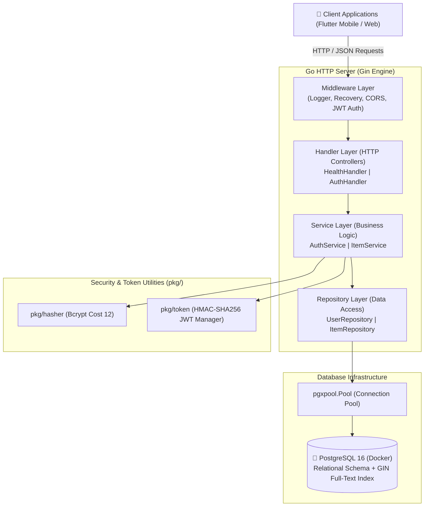
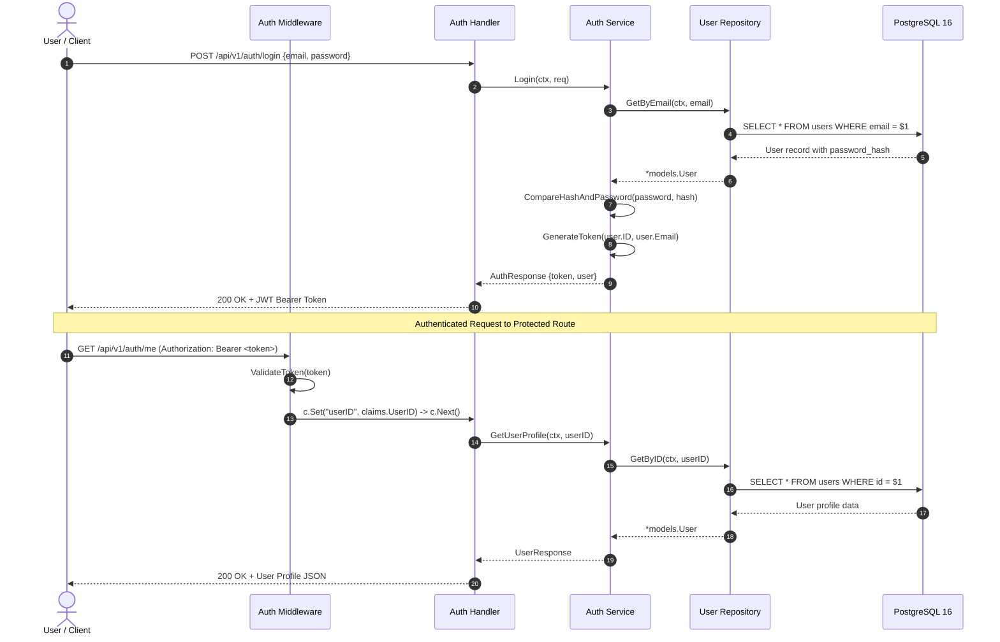
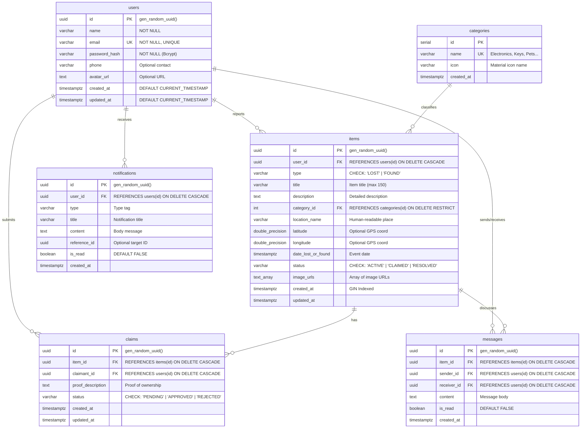

# 🔍 FindIt — Community Lost & Found Recovery Platform

[](https://golang.org)
[](https://gin-gonic.com)
[](https://www.postgresql.org)
[](https://www.docker.com)
[](https://jwt.io)
[](LICENSE)

> A modern, resilient, high-performance community platform designed to connect people who lost valuable belongings with finders who recovered them — powered by Go Clean Architecture, PostgreSQL 16 Full-Text Search, and Docker.

---

## 📖 Table of Contents

- [Overview](#-overview)
- [Key Features](#-key-features)
- [System Architecture](#-system-architecture)
- [Database Design & Schema](#-database-design--schema)
- [Project Directory Structure](#-project-directory-structure)
- [API Reference & Endpoints](#-api-reference--endpoints)
- [Getting Started](#-getting-started)
  - [Prerequisites](#prerequisites)
  - [Environment Configuration](#1-environment-configuration)
  - [Start Database (Docker Compose)](#2-start-database-via-docker-compose)
  - [Run Database Migrations](#3-apply-sql-migrations)
  - [Run the Backend Server](#4-run-the-go-backend-api)
- [Running Tests](#-running-tests)
- [Development Roadmap](#-development-roadmap)
- [Documentation & Learning Resources](#-documentation--learning-resources)
- [License](#-license)

---

## 🌟 Overview

Losing a valuable item — a laptop, wallet, passport, set of keys, or cherished pet — is stressful. Traditional lost-and-found processes are fragmented across social media groups, physical bulletin boards, and campus desks.

**FindIt** solves this by providing a unified, secure, and searchable platform:
- **Reporters** can quickly publish structured posts for lost or found items with location details, categories, timestamps, and images.
- **Finders & Owners** can search using PostgreSQL Full-Text Search (GIN indexing) to match lost and found items.
- **Ownership Verification** ensures items are returned safely through an item claims workflow with verification proof and approval statuses.
- **Security & Privacy** protect users with JWT token authentication, Bcrypt password hashing, and role/ownership authorization.

---

## ✨ Key Features

- **🛡️ Secure Authentication Layer**: User registration and login powered by Bcrypt password hashing (cost factor 12) and cryptographic JWT token issuance (`golang-jwt/jwt/v5`).
- **🔒 Protected Routes & Context Injection**: Robust Gin middleware validating Bearer tokens and injecting authenticated user credentials (`userID`, `userEmail`, `claims`) into the request context.
- **⚡ High-Performance Clean Architecture**: Strict separation of concerns following industry-standard clean layered architecture:
  - **Handlers**: HTTP parsing, validation, and JSON serialization.
  - **Services**: Business logic, security invariants, and domain rules.
  - **Repositories**: SQL queries, parameterization, and database interactions.
  - **Models / DTOs**: Strongly-typed Go structs with validator tags.
- **🐘 PostgreSQL 16 with Connection Pooling**: Powered by `jackc/pgx/v5` with production-tuned pool settings (`MaxConns`, `MinConns`, idle timeouts, lifetime reclamation, and live health pings).
- **🔎 Full-Text Search Ready**: Dedicated PostgreSQL Generalized Inverted Index (GIN) on English text vectors (`idx_items_search`) for rapid title and description searches.
- **🛑 Zero-Downtime Graceful Shutdown**: Gracefully drains active HTTP connections and closes database pools upon receiving `SIGINT` or `SIGTERM` OS signals.
- **🌐 Cross-Origin Resource Sharing (CORS)**: Configured CORS middleware supporting cross-platform web and mobile clients (Flutter).
- **🧪 100% Testable & Isolated**: Handlers, services, repositories, and utility packages are backed by comprehensive unit and integration tests with mock implementations.

---

## 🏗️ System Architecture

FindIt follows **Clean Layered Architecture**, ensuring high testability, maintainability, and clean decoupling:



### Request Lifecycle & Authentication Flow



---

## 🗄️ Database Design & Schema

The database is built on **PostgreSQL 16** with strong referential integrity, UUIDv4 primary keys, strict foreign key constraints, and performance indexes.



### Key Database Optimizations
- **GIN Full-Text Search**: `CREATE INDEX idx_items_search ON items USING gin (to_tsvector('english', title || ' ' || description));`
- **Composite Query Indexes**: `(type, status)` for fast filtering of active lost/found items.
- **Chronological Sorting**: `created_at DESC` indexing for instant feed loading.
- **Safe Relational Cascades**: Deleting an item automatically cleans up associated claims and conversation messages.

---

## 📁 Project Directory Structure

```text
FindIt/
├── backend/
│   ├── bin/                        # Compiled executable binaries (git-ignored)
│   ├── cmd/
│   │   └── api/
│   │       ├── main.go             # Application entrypoint & dependency wiring
│   │       └── main_test.go        # HTTP server and router setup tests
│   ├── internal/
│   │   ├── config/                 # Environment variables & configuration loading
│   │   │   ├── config.go
│   │   │   └── config_test.go
│   │   ├── database/               # PostgreSQL connection pool (pgxpool)
│   │   │   ├── db.go
│   │   │   └── db_test.go
│   │   ├── handler/                # HTTP request handlers (Waiters)
│   │   │   ├── auth.go             # /register, /login, /me handlers
│   │   │   ├── auth_test.go
│   │   │   ├── health.go           # /health handler
│   │   │   └── health_test.go
│   │   ├── middleware/             # HTTP middleware (CORS, JWT Authentication)
│   │   │   ├── auth.go
│   │   │   ├── auth_test.go
│   │   │   ├── cors.go
│   │   │   └── cors_test.go
│   │   ├── models/                 # Domain entities and Request/Response DTOs
│   │   │   ├── user.go
│   │   │   └── user_test.go
│   │   ├── repository/             # Database access layer (Pantry workers)
│   │   │   ├── user_repository.go
│   │   │   └── user_repository_test.go
│   │   └── service/                # Business logic layer (Chefs)
│   │       ├── auth_service.go
│   │       └── auth_service_test.go
│   ├── migrations/                 # Version-controlled SQL migrations
│   │   ├── 000001_init_schema.up.sql
│   │   └── 000001_init_schema.down.sql
│   ├── pkg/                        # Reusable utility packages
│   │   ├── hasher/                 # Bcrypt password hashing & verification
│   │   │   ├── hasher.go
│   │   │   └── hasher_test.go
│   │   └── token/                  # JWT generation & cryptographic validation
│   │       ├── jwt.go
│   │       └── jwt_test.go
│   ├── go.mod                      # Go module definition
│   └── go.sum                      # Checksums of dependencies
├── .env.example                    # Sample environment variables
├── .gitignore                      # Git ignore patterns
├── docker-compose.yml              # Local PostgreSQL 16 container definition
├── CODE_EXPLANATION.md             # In-depth architectural & beginner guide
├── LEARNING_GUIDE.md               # Quick concept guide & analogies
├── STEPS.md                        # Complete 15-step project roadmap
└── README.md                       # Project documentation (this file)
```

---

## 📡 API Reference & Endpoints

All endpoints are prefixed with `/api/v1`.

| Method | Endpoint | Auth Required | Description |
|---|---|:---:|---|
| `GET` | `/api/v1/health` | ❌ No | System health check & database ping status |
| `POST` | `/api/v1/auth/register` | ❌ No | Register a new user account |
| `POST` | `/api/v1/auth/login` | ❌ No | Authenticate user & issue JWT Bearer token |
| `GET` | `/api/v1/auth/me` | ✅ Yes | Retrieve the authenticated user's profile |

---

### Detailed Endpoint Specifications

#### 1. System Health Check
`GET /api/v1/health`

**Response (`200 OK`):**
```json
{
  "status": "healthy",
  "database": "connected",
  "timestamp": "2026-11-12T22:30:00Z"
}
```

---

#### 2. User Registration
`POST /api/v1/auth/register`

**Request Body:**
```json
{
  "name": "Jane Doe",
  "email": "jane@example.com",
  "password": "SecurePassword123!",
  "phone": "+1234567890"
}
```

**Response (`201 Created`):**
```json
{
  "token": "eyJhbGciOiJIUzI1NiIsInR5cCI6IkpXVCJ9...",
  "user": {
    "id": "c1f7b029-7981-49b8-a6e5-4f4de13a1a3b",
    "name": "Jane Doe",
    "email": "jane@example.com",
    "phone": "+1234567890",
    "avatar_url": "",
    "created_at": "2026-11-12T22:30:00Z"
  }
}
```

---

#### 3. User Login
`POST /api/v1/auth/login`

**Request Body:**
```json
{
  "email": "jane@example.com",
  "password": "SecurePassword123!"
}
```

**Response (`200 OK`):**
```json
{
  "token": "eyJhbGciOiJIUzI1NiIsInR5cCI6IkpXVCJ9...",
  "user": {
    "id": "c1f7b029-7981-49b8-a6e5-4f4de13a1a3b",
    "name": "Jane Doe",
    "email": "jane@example.com",
    "phone": "+1234567890",
    "avatar_url": "",
    "created_at": "2026-11-12T22:30:00Z"
  }
}
```

---

#### 4. Current User Profile
`GET /api/v1/auth/me`

**Headers:**
```http
Authorization: Bearer <your_jwt_token_here>
```

**Response (`200 OK`):**
```json
{
  "id": "c1f7b029-7981-49b8-a6e5-4f4de13a1a3b",
  "name": "Jane Doe",
  "email": "jane@example.com",
  "phone": "+1234567890",
  "avatar_url": "",
  "created_at": "2026-11-12T22:30:00Z"
}
```

---

## 🚀 Getting Started

### Prerequisites

Make sure you have the following installed on your machine:
- **Go**: Version `1.25` or higher ([Download Go](https://go.dev/dl/))
- **Docker & Docker Compose**: ([Download Docker Desktop](https://www.docker.com/products/docker-desktop/))
- **Git**: ([Download Git](https://git-scm.com/))

---

### 1. Environment Configuration

Clone the repository and copy the example environment file:

```bash
git clone https://github.com/MohammedaminSa/FindIt.git
cd FindIt

# Copy the sample environment file
cp .env.example .env
```

Review or modify your `.env` settings:

```dotenv
# Database Configuration
DB_HOST=localhost
DB_PORT=5432
DB_USER=findit_user
DB_PASSWORD=findit_secret
DB_NAME=findit_db
DB_SSLMODE=disable

# Application Configuration
SERVER_PORT=8080
ENVIRONMENT=development
JWT_SECRET=findit_jwt_super_secret_key_change_in_production
```

---

### 2. Start Database via Docker Compose

Launch the PostgreSQL 16 container with persistent volume storage:

```bash
docker compose up -d
```

Verify that the container is healthy:

```bash
docker compose ps
```

---

### 3. Apply SQL Migrations

Apply the initial relational schema and seed default categories:

```bash
# On Linux / macOS / Git Bash:
docker compose exec -i postgres psql -U findit_user -d findit_db < backend/migrations/000001_init_schema.up.sql

# On Windows PowerShell:
Get-Content backend\migrations\000001_init_schema.up.sql | docker compose exec -T postgres psql -U findit_user -d findit_db
```

Verify that the tables were created:

```bash
docker compose exec postgres psql -U findit_user -d findit_db -c "\dt"
```

---

### 4. Run the Go Backend API

Navigate to the `backend` directory and start the server:

```bash
cd backend
go run cmd/api/main.go
```

You should see log output similar to:
```text
PostgreSQL connection pool established successfully
FindIt API server listening on http://localhost:8080 (development mode)
```

Test the health endpoint in another terminal or browser:

```bash
curl http://localhost:8080/api/v1/health
```

---

## 🧪 Running Tests

All packages are backed by automated tests:

```bash
cd backend

# Run all unit tests across the entire codebase
go test -v ./...

# Run tests with test coverage summary
go test -cover ./...

# Run tests for a specific package (e.g. auth handler)
go test -v ./internal/handler/...
```

---

## 🗺️ Development Roadmap

Track our step-by-step progress through all phases (refer to [`STEPS.md`](STEPS.md) for full task details):

- [x] **Phase 1: Environment & Database Foundation**
  - [x] Step 1: Dockerized PostgreSQL 16, Git repository & environment config
  - [x] Step 2: Relational database schema, indexes, seed categories & rollback migrations
- [ ] **Phase 2: Go Backend Architecture & Security**
  - [x] Step 3: Clean Architecture scaffolding, `pgxpool` connection pool & Gin engine
  - [x] Step 4: Authentication & Security Layer (Bcrypt, JWT, Handlers, Middleware)
- [ ] **Phase 3: Core Domain Services (Lost & Found Features)**
  - [ ] Step 5: Category & Item Reporting APIs (Image uploads & geolocation)
  - [ ] Step 6: Search & Filtering Engine (PostgreSQL GIN Full-Text Search)
  - [ ] Step 7: Ownership Claims Lifecycle & Verification Workflow
  - [ ] Step 8: In-App Messaging & Notifications
- [ ] **Phase 4: Flutter Mobile Application**
  - [ ] Step 9: Flutter scaffolding & Riverpod state architecture
  - [ ] Step 10: Authentication UI & Auth state flow
  - [ ] Step 11: Discovery feed, search & filter UI
  - [ ] Step 12: Item reporting flow (Post Lost/Found)
  - [ ] Step 13: Claim submission & review dashboard
  - [ ] Step 14: Real-time messaging & chat screen
- [ ] **Phase 5: Production Deployment & DevOps**
  - [ ] Step 15: Production multi-stage Docker containerization & cloud deployment

---

## 📚 Documentation & Learning Resources

This repository includes comprehensive learning materials:

| Document | Purpose |
|---|---|
| [**`STEPS.md`**](STEPS.md) | Master checklist tracking every milestone, sub-step, and verification command. |
| [**`LEARNING_GUIDE.md`**](LEARNING_GUIDE.md) | High-level architectural explanations, design decisions, and real-world analogies. |
| [**`CODE_EXPLANATION.md`**](CODE_EXPLANATION.md) | In-depth line-by-line guide explaining all Go, Gin, and SQL concepts. |

---

## 📄 License

This project is open-source and distributed under the [MIT License](LICENSE).
Feel free to use, modify, and distribute with attribution.
